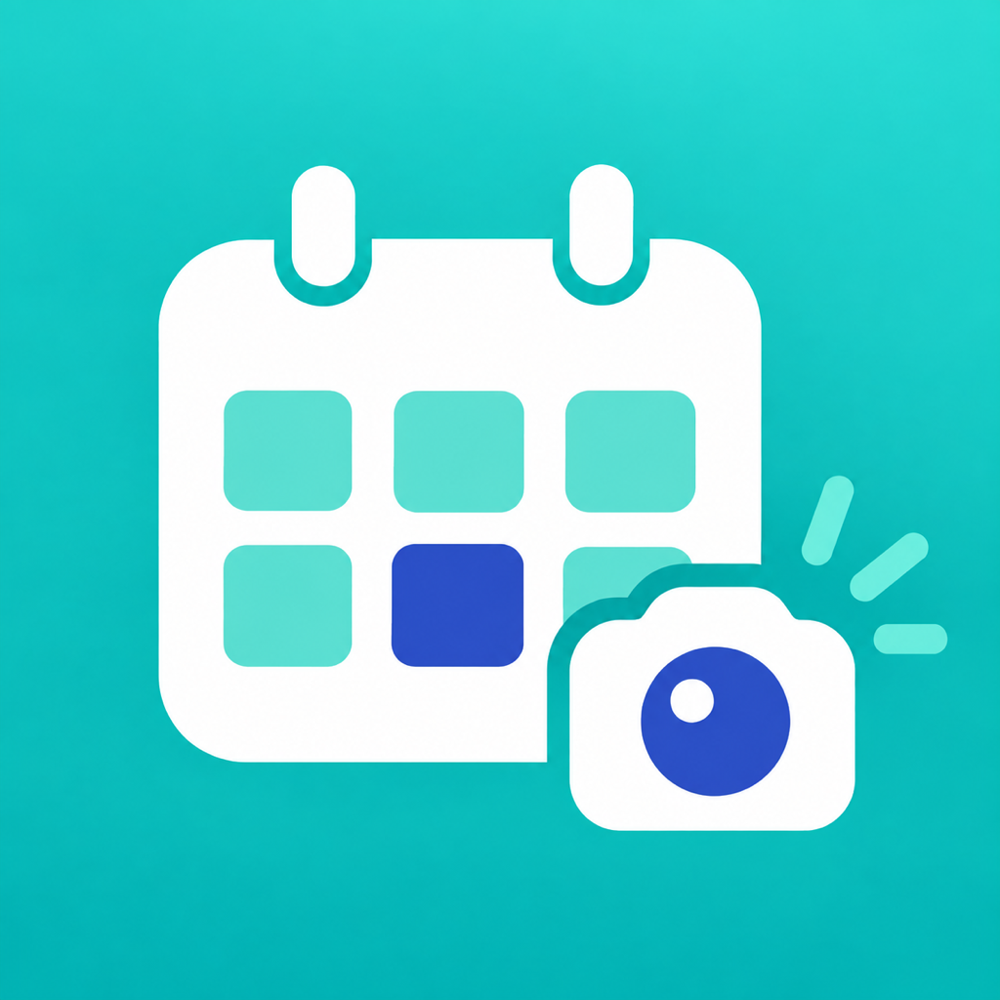
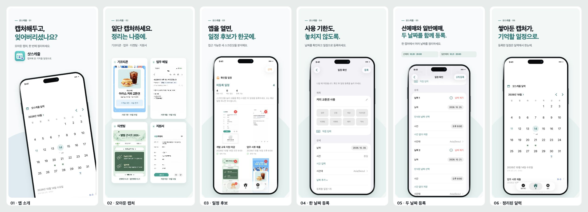
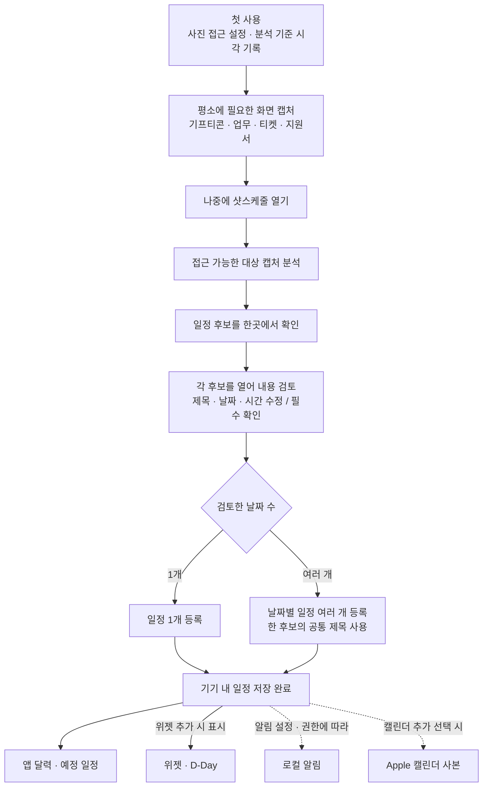

<p align="center">
  
</p>

# 샷스케줄 · ShotToSchedule

**캡처는 그때그때, 정리는 한 번에.**

기프티콘 사용 기한, 업무 메일의 제출일, 티켓 예매일, 지원서 마감일.
기억하려고 캡처했지만 사진첩에 묻혀 잊어버리는 순간을 줄이기 위해 만든 iPhone·iPad 앱입니다.

앱을 열면 접근 가능한 새 스크린샷에서 글자와 날짜를 읽고 일정 후보를 모아 보여줍니다. 필요한 후보의 제목·날짜·시간을 확인하고 등록하면 달력과 위젯에서 다시 확인할 수 있습니다.

> Capture now, organize later. ShotToSchedule finds event suggestions in accessible new screenshots, lets you review the details, and keeps the events you register on your device.



## 링크

| 구분 | 링크 |
|---|---|
| 웹사이트 | [샷스케줄](https://shottoschedule.newwren3.chatgpt.site) |
| 사용 안내·문의 | [한국어](https://shottoschedule.newwren3.chatgpt.site/support.html) · [English](https://shottoschedule.newwren3.chatgpt.site/en/support.html) · [日本語](https://shottoschedule.newwren3.chatgpt.site/ja/support.html) |
| 개인정보처리방침 | [한국어](https://shottoschedule.newwren3.chatgpt.site/privacy.html) · [English](https://shottoschedule.newwren3.chatgpt.site/en/privacy.html) · [日本語](https://shottoschedule.newwren3.chatgpt.site/ja/privacy.html) |
| 소개 이미지 원본 | [언어·기기별 이미지 모음](docs/SCREENSHOTS.md) |

**App Store:** 2026년 10월 11일 버전 1.0(빌드 4)을 심사 제출했습니다. 공개 출시 후 다운로드 링크를 추가할 예정입니다.

## 어떤 일을 할 수 있나요?

| 상황 | 앱에서 정리할 일정 |
|---|---|
| 기프티콘을 캡처해 두었을 때 | 사용 기한 |
| 업무 메일을 캡처했을 때 | 서류 제출일 |
| 티켓 오픈 안내를 캡처했을 때 | 선예매·일반예매 등 여러 날짜 |
| 모집 공고를 캡처했을 때 | 지원 마감일 |

- **후보 검토:** 등록할 일정과 검토 중인 후보를 구분하고 인식 결과를 수정합니다.
- **여러 날짜:** 한 캡처에서 인식한 날짜를 검토하고 여러 일정을 등록합니다.
- **일정 조회:** 달력과 다가오는 일정 목록에서 등록한 일정을 확인합니다.
- **알림:** 하루 전·당일 알림을 선택합니다.
- **위젯:** 등록한 일정과 D-Day를 확인하고 해당 일정으로 이동합니다.
- **Apple 캘린더:** 원하는 일정의 사본을 선택적으로 추가합니다.
- **현지화:** 한국어·영어·일본어를 지원합니다.

스크린샷을 찍는 것만으로 앱이 자동 실행되지는 않습니다. 앱을 열 때 분석하며, 제한적인 사진 접근에서는 허용한 사진만 분석할 수 있습니다. 인식 결과는 등록 전에 확인해야 합니다.

## 캡처 이후의 사용자 흐름



처음 사진을 읽을 수 있는 상태에서 분석을 시작할 때 기준 시각을 기록합니다. 이후 생성된 접근 가능한 스크린샷이 대상이며, 완료한 캡처는 다시 분석하지 않습니다. 유효한 날짜가 없거나 앱 자신의 일정 화면으로 판별된 캡처는 후보를 만들지 않습니다.

후보 목록은 여러 캡처를 모아서 보여주고, 등록은 **후보별 상세 화면**에서 진행합니다. 한 후보 안의 여러 날짜는 함께 등록할 수 있습니다. 목록의 다중 선택은 후보 제외용입니다.

[내부 아키텍처와 코드 대조 결과](docs/ARCHITECTURE.md)

## 사용 기술

| 기술 | 역할 |
|---|---|
| Swift 6 · SwiftUI | 앱 화면, 편집 흐름, 상태 관리 |
| PhotoKit | 접근 가능한 스크린샷 탐색·이미지 읽기 |
| Apple Vision | 기기 내 문자 인식 |
| SwiftData | 스캔 상태·일정 후보·등록 일정 저장 |
| UIKit · UICalendarView | 홈 달력 |
| UserNotifications | 선택한 일정의 로컬 알림 |
| EventKit | Apple 캘린더에 일정 사본 추가 |
| WidgetKit · App Groups | 등록 일정 스냅샷 공유·위젯 표시 |
| Google Mobile Ads · UMP | 광고 구성 검증·개인정보 선택 처리 |

문자 인식과 일정 저장은 기기에서 이루어집니다. 사진·OCR 원문·일정 내용은 개발자 서버나 광고 SDK로 전송하지 않습니다. 광고 및 개인정보 선택 기능에는 Google SDK 통신이 사용됩니다.

## 구현에서 신경 쓴 부분

1. **일정 후보와 등록 일정을 분리:** 인식한 내용을 바로 확정하지 않고 사용자가 검토한 뒤 등록하도록 설계했습니다.
2. **날짜·시간·시간대 구분:** 종일 일정과 시간이 있는 일정을 구분하고, 여러 날짜를 편집할 수 있게 했습니다.
3. **권한에 맞는 동작:** 사진 접근 범위와 알림 권한에 따라 동작하며, 권한 요청을 직접 선택할 수 있습니다.
4. **위젯과 앱 연결:** 등록한 일정만 스냅샷으로 공유하고 일정 링크를 통해 앱의 해당 일정으로 이동합니다.
5. **외부 경계의 테스트:** 사진 읽기·알림·캘린더·광고 동작을 대체 가능한 경계로 나눠 합성 데이터로 검사합니다.

[구조 설명](docs/ARCHITECTURE.md) · [공개 자료와 제외 자료](docs/PUBLICATION.md)

## 로컬에서 실행하기

필요 환경: **macOS, Swift 6을 지원하는 Xcode, iOS/iPadOS 17 이상**.

```bash
git clone https://github.com/MirrorPI/SnapSchedule.git
cd SnapSchedule
open SnapSchedule.xcodeproj
```

1. `SnapSchedule` Scheme과 iPhone 또는 iPad Simulator를 선택합니다.
2. 기본 Debug/QA 구성은 Google 공식 테스트 광고 ID를 사용합니다.
3. 실제 기기에서 실행할 때는 앱과 위젯의 Signing Team, Bundle ID, App Group을 본인 계정에 맞게 설정해야 합니다. App Group을 바꿀 때는 양쪽 entitlement와 `Shared/WidgetScheduleSnapshot.swift`도 함께 맞춥니다.
4. 공개용 `Production.xcconfig`에는 운영 광고 ID가 없습니다. SDK 시작에 필요한 공식 테스트 App ID만 별도로 설정되어 있으며, 운영 광고 구성은 비활성 상태입니다.

`SnapScheduleTests`에는 날짜 해석, 후보 검토, 일정 등록, 저장, 알림, 위젯 등 테스트와 합성 OCR 이미지가 포함되어 있습니다. 실제 기기용 UI 테스트는 과거 검증을 위한 선택 실행 도구이므로 일반적인 로컬 실행에 필요하지 않습니다.

## 소개 이미지에 관하여

한국어·영어·일본어 각각 iPhone 6장, iPad 6장으로 **총 36장**입니다. 실제 앱 화면에 가상의 검토 완료 후보와 일정을 넣어 촬영했습니다. 이미지 안의 기프티콘·메일·공연·모집 공고는 공통 한국어 가상 예시이며, 실제 쿠폰 번호나 사용자 메일은 포함하지 않습니다. 이 시연 이미지는 자동 인식 정확도를 측정한 결과가 아닙니다.

Apple 캘린더로 추가한 사본은 앱에서 수정·삭제해도 자동 변경되지 않습니다. 알림 전달과 위젯 갱신은 OS 설정 및 시스템 제한의 영향을 받습니다.

## 라이선스

현재 별도의 오픈소스 라이선스를 부여하지 않았습니다. 코드의 재사용·재배포는 별도 허락을 받아주세요. 외부 SDK의 라이선스는 각 공급자의 조건을 따릅니다.
