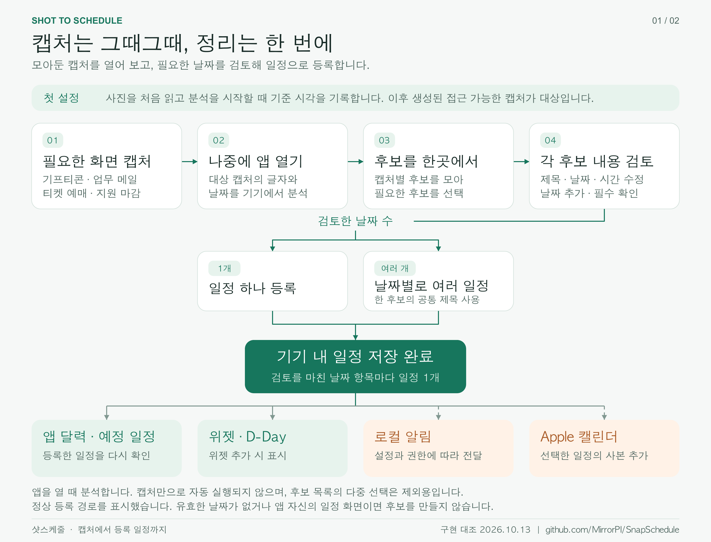
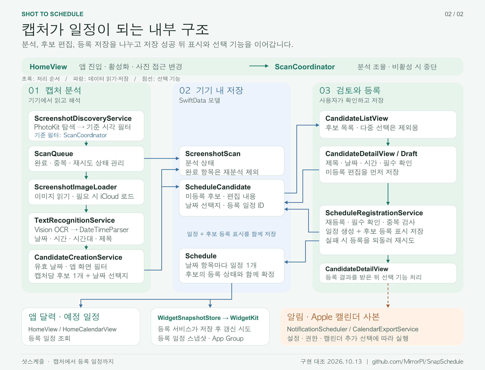

# 캡처 이후의 흐름과 아키텍처

현재 구현을 기준으로 사용자 흐름과 내부 처리 관계를 정리했습니다. 2026년 10월 13일 실제 소스와 대조했고, 분석 기준·후보 생성·날짜 추가·등록 저장에 관한 기존 동작 테스트를 확인했습니다.

[PDF 원본 보기 · 사용자 흐름과 내부 구조 2페이지](images/shottoschedule-flow-architecture.pdf)

## 사용자 흐름

아래는 사진 접근이 가능하고, 검토할 날짜 후보가 발견되는 정상 등록 경로입니다. 점선은 사용자가 선택하고 권한 조건을 충족했을 때 실행하는 기능입니다.

## 내부 처리 구조

가독성을 위해 인접한 분석 단계를 같은 카드에 묶었습니다. 초록 화살표는 처리 순서를, 파랑 화살표는 데이터 읽기·저장을, 점선은 선택 기능을 나타냅니다. 분석 단계는 `ScanCoordinator`가 조율합니다. 저장 모델에서 다른 서비스로 이어지는 선이 SwiftData의 자동 실행 트리거를 의미하지는 않습니다.

## 코드로 확인한 동작

| 확인 항목 | 실제 구현 | 근거 |
|---|---|---|
| 분석 시작 | 앱 첫 진입, 다시 활성화, 활성 상태에서 사진 접근 상태 변경 시 분석 조율을 호출합니다. 비활성화하면 진행 작업을 취소합니다. | [HomeView](../SnapSchedule/Features/Home/HomeView.swift#L163) |
| 최초 기준 시각 | 사진을 읽을 수 있는 상태의 첫 분석에서 `analysisDate()`를 저장합니다. 사진 권한 버튼을 누른 순간이나 앱 설치 시각을 직접 사용하는 방식은 아닙니다. | [analysisBaseline](../SnapSchedule/Scanning/ScanCoordinator.swift#L353) |
| 대상 캡처 | PhotoKit에서 스크린샷 subtype과 접근 범위를 확인한 뒤, 조율자가 생성 시각이 기준보다 늦은 캡처만 남깁니다. 생성 시각이 없는 캡처도 제외합니다. | [탐색](../SnapSchedule/PhotoLibrary/ScreenshotDiscoveryService.swift#L29) · [기준 필터](../SnapSchedule/Scanning/ScanCoordinator.swift#L364) |
| 분석 상태 | 완료한 캡처는 유지하고, 접근 가능한 미완료·실패 항목을 다시 처리할 수 있도록 상태를 관리합니다. 문자 인식 실패와 접근 불가는 별도 상태입니다. | [ScanQueue](../SnapSchedule/Scanning/ScanQueue.swift#L23) · [오류 처리](../SnapSchedule/Scanning/ScanCoordinator.swift#L267) |
| 이미지와 OCR | 이미지를 읽고 필요하면 iCloud 다운로드를 기다립니다. Apple Vision의 인식 결과를 날짜 해석기에 넘깁니다. | [이미지 로더](../SnapSchedule/PhotoLibrary/ScreenshotImageLoader.swift) · [문자 인식](../SnapSchedule/OCR/TextRecognitionService.swift) · [분석 호출](../SnapSchedule/Scanning/ScanCoordinator.swift#L245) |
| 후보 생성 | 유효한 날짜가 있는 초안을 추리고 앱 자신의 일정 화면을 필터링합니다. 새 캡처마다 후보 1개를 만들며, 여러 인식 날짜는 `recognizedDateOptions`로 보관합니다. 기존 후보를 자동 덮어쓰거나 추가하지 않습니다. | [CandidateCreationService](../SnapSchedule/Candidates/CandidateCreationService.swift#L27) |
| 날짜 선택과 추가 | 후보의 최초 등록 날짜 항목은 기본 1개입니다. 편집 화면에서 인식된 날짜를 선택하거나 항목을 추가·삭제·수정하고 필수 확인을 해결합니다. 모든 인식 날짜가 자동 등록되는 것은 아닙니다. | [날짜 항목](../SnapSchedule/Models/ScheduleCandidate.swift#L35) · [추가 동작](../SnapSchedule/Features/Candidates/CandidateDetailView.swift#L98) |
| 후보별 등록 | UI는 상세 화면에서 해당 후보 1개를 등록 서비스에 넘깁니다. 서비스 자체는 후보 ID 집합을 받을 수 있지만, 목록의 다중 선택 기능은 후보 제외용입니다. | [상세 등록](../SnapSchedule/Features/Candidates/CandidateDetailView.swift#L196) · [목록 선택](../SnapSchedule/Features/Candidates/CandidateListView.swift#L89) |
| 일정 생성 | 편집한 날짜 항목마다 일정 1개를 만들며, 한 후보의 제목과 알림·캘린더 선택을 공유합니다. 최신 저장 상태로 재등록과 필수 확인·중복 날짜를 검사합니다. | [ScheduleRegistrationService](../SnapSchedule/Schedules/ScheduleRegistrationService.swift#L54) |
| 저장 경계 | 미등록 후보의 편집 내용을 먼저 저장합니다. 이후 생성 일정 전체와 후보의 등록 상태·연결 ID를 한 번의 저장으로 확정합니다. 등록 저장 실패 시 생성 일정과 등록 표시를 되돌리고, 이미 저장한 편집 내용은 유지합니다. | [편집 저장과 등록](../SnapSchedule/Features/Candidates/CandidateDetailView.swift#L196) · [등록 저장](../SnapSchedule/Schedules/ScheduleRegistrationService.swift#L104) |
| 저장 후 기능 | 등록 서비스가 저장 성공 후 위젯 스냅샷 갱신을 시도합니다. 상세 화면은 등록 결과를 받은 뒤 알림 권한·동기화와 요청한 캘린더 사본 처리를 이어갑니다. 이 기능의 실패가 등록된 일정을 취소하지 않습니다. | [위젯 갱신](../SnapSchedule/Schedules/ScheduleRegistrationService.swift#L125) · [선택 기능](../SnapSchedule/Features/Candidates/CandidateDetailView.swift#L491) |

## 검증 범위

일정 처리 경로에 해당하는 구현 15개 파일이 원래 작업 소스와 공개 저장소에서 동일함을 확인했습니다. 가짜 사진 탐색·합성 날짜·메모리 저장소를 사용하는 아래 기존 테스트 **6개가 모두 통과했습니다(실패 0개)**.

- `ScanCoordinatorTests.testFirstReadableActivationPersistsBaselineBeforeDiscoveryCompletes`
- `ScanCoordinatorTests.testFirstReadableActivationEstablishesBaselineWithoutAnalyzingExistingScreenshots`
- `ScanCoordinatorTests.testLaterActivationAnalyzesOnlyScreenshotsCapturedAfterPersistedBaseline`
- `CandidateCreationServiceTests.testNewPhotoWithSeveralDatesCreatesOneReviewCandidate`
- `CandidateDetailEditorTests.testAddDateUsesNextUnusedRecognizedDayAndLeavesExhaustedRowBlank`
- `ScheduleRegistrationServiceTests.testSaveFailureRollsBackEveryScheduleAndCandidateThenRetrySucceeds`

이 검증은 분석 기준·후보 생성·날짜 항목·등록 저장의 동작 확인입니다. 실제 기기·사용자 사진·운영 광고 요청을 새로 시험하거나 실제 캡처의 OCR 정확도를 측정한 결과는 아닙니다.

## 코드 위치

| 경로 | 역할 |
|---|---|
| `SnapSchedule/PhotoLibrary/` | 사진 접근 상태, 스크린샷 탐색, 이미지 로딩 |
| `SnapSchedule/OCR/` | Apple Vision 문자 인식 |
| `SnapSchedule/Parsing/` | 날짜·시간 후보 해석 |
| `SnapSchedule/Scanning/` | 스캔 큐와 분석 진행 상태 |
| `SnapSchedule/Candidates/` | 후보 생성·제외 |
| `SnapSchedule/Features/Candidates/` | 후보 목록·선택·날짜 편집 화면 |
| `SnapSchedule/Schedules/` | 등록, 수정, 삭제, 표시용 날짜 처리 |
| `SnapSchedule/Models/`, `Persistence/` | 스캔·후보·일정 모델과 저장 |
| `SnapSchedule/Notifications/` | 권한, 알림 계획, 알림 스케줄링 |
| `SnapSchedule/Calendar/` | Apple 캘린더 사본 추가 |
| `SnapSchedule/WidgetSharing/`, `Shared/` | 등록 일정 스냅샷과 공유 타입 |
| `SnapScheduleWidget/` | 위젯 타임라인·화면·일정 링크 |
| `SnapSchedule/Ads/` | 구성 검증, 동의 상태, 배너 생명주기 |
| `SnapScheduleTests/` | 단위·통합 테스트와 합성 이미지 |

## 데이터와 외부 동작

사진·OCR 원문·일정 내용은 개발자 서버나 광고 SDK에 전달하지 않습니다. 사진이 iCloud에만 있을 때의 이미지 다운로드, 선택한 Apple 캘린더 계정의 동기화, Google 광고·개인정보 SDK 통신은 각각 별도 경계입니다. 이 그림은 캡처에서 일정으로 이어지는 경로를 설명하며 광고 동의·SDK 초기화 전체 구조를 포함하지 않습니다.

Apple 캘린더에는 사본을 추가합니다. 앱의 수정·삭제가 기존 캘린더 사본에 자동 반영되지는 않습니다. 위젯 표시와 알림 전달에는 OS 설정 및 시스템 제한이 적용됩니다.

공개 사본은 운영 광고 ID와 개인 Signing Team을 제외한 설정을 사용합니다. 이번 그래프 검증·문서 추가는 앱 제품 코드나 출시 빌드 변경을 포함하지 않습니다.
