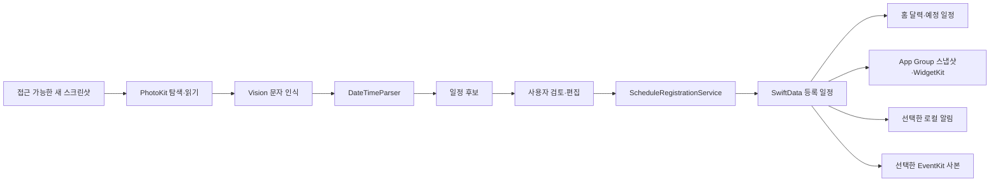

# 앱 구조

앱의 주요 흐름은 **스크린샷 탐색 → 문자 인식 → 날짜 해석 → 후보 검토 → 일정 등록 → 조회**입니다.

## 코드 위치

| 경로 | 역할 |
|---|---|
| `SnapSchedule/PhotoLibrary/` | 사진 접근 상태, 스크린샷 탐색, 이미지 로딩 |
| `SnapSchedule/OCR/` | Apple Vision 문자 인식 |
| `SnapSchedule/Parsing/` | 날짜·시간 후보 해석 |
| `SnapSchedule/Scanning/` | 스캔 큐와 분석 진행 상태 |
| `SnapSchedule/Candidates/` | 후보 생성·제외 |
| `SnapSchedule/Features/Candidates/` | 후보 목록·선택·날짜 편집 화면 |
| `SnapSchedule/Schedules/` | 등록, 수정, 삭제, 표시용 날짜 처리 |
| `SnapSchedule/Models/`, `Persistence/` | 스캔·후보·일정 모델과 저장 |
| `SnapSchedule/Notifications/` | 권한, 알림 계획, 알림 스케줄링 |
| `SnapSchedule/Calendar/` | Apple 캘린더 사본 추가 |
| `SnapSchedule/WidgetSharing/`, `Shared/` | 등록 일정 스냅샷과 공유 타입 |
| `SnapScheduleWidget/` | 위젯 타임라인·화면·일정 링크 |
| `SnapSchedule/Ads/` | 구성 검증, 동의 상태, 배너 생명주기 |
| `SnapScheduleTests/` | 단위·통합 테스트와 합성 이미지 |

## 데이터와 외부 동작

스캔한 화면, 검토할 후보, 등록한 일정은 별도 모델로 구분합니다. 후보 등록에서는 선택한 날짜별 일정을 만들고 원본 후보와 연결합니다. 일정 조회와 위젯에는 등록한 일정이 표시됩니다.

사진·알림·캘린더 권한과 광고 처리는 각각의 서비스에서 관리합니다. 앱의 일정 기능에 필요한 사진·OCR 원문·일정 내용은 개발자 서버나 광고 SDK에 전달하지 않으며, Google 광고·개인정보 SDK의 통신은 별도 경계입니다.

이 공개 사본은 운영 광고 ID와 개인 Signing Team을 제외한 배포본입니다. 앱 제품 소스는 그대로 유지하고 공개 설정 및 관련 광고 테스트만 조정했습니다.
