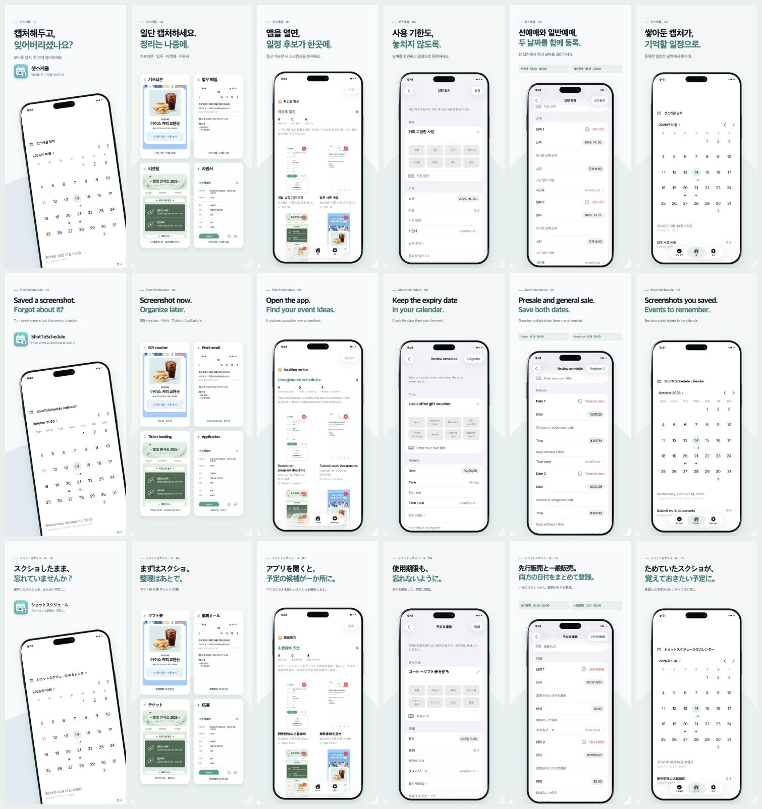

# 소개 이미지

한국어·영어·일본어 × iPhone·iPad × 6장, 총 **36장**입니다. 앱 UI와 제목·설명은 언어별로 적용했고, 캡처 속 안내문은 공통 한국어 가상 예시입니다.

## 한국어

| 순서 | 화면 | iPhone | iPad |
|---|---|---|---|
| 1 | 앱 소개 | [원본](images/iphone/ko/01-intro.jpg) | [원본](images/ipad/ko/01-intro.jpg) |
| 2 | 모아둔 캡처 | [원본](images/iphone/ko/02-captures.jpg) | [원본](images/ipad/ko/02-captures.jpg) |
| 3 | 일정 후보 | [원본](images/iphone/ko/03-candidates.jpg) | [원본](images/ipad/ko/03-candidates.jpg) |
| 4 | 한 날짜 등록 | [원본](images/iphone/ko/04-single.jpg) | [원본](images/ipad/ko/04-single.jpg) |
| 5 | 두 날짜 등록 | [원본](images/iphone/ko/05-multiple.jpg) | [원본](images/ipad/ko/05-multiple.jpg) |
| 6 | 정리된 달력 | [원본](images/iphone/ko/06-calendar.jpg) | [원본](images/ipad/ko/06-calendar.jpg) |

## English

| 순서 | 화면 | iPhone | iPad |
|---|---|---|---|
| 1 | 앱 소개 | [원본](images/iphone/en/01-intro.jpg) | [원본](images/ipad/en/01-intro.jpg) |
| 2 | 모아둔 캡처 | [원본](images/iphone/en/02-captures.jpg) | [원본](images/ipad/en/02-captures.jpg) |
| 3 | 일정 후보 | [원본](images/iphone/en/03-candidates.jpg) | [원본](images/ipad/en/03-candidates.jpg) |
| 4 | 한 날짜 등록 | [원본](images/iphone/en/04-single.jpg) | [원본](images/ipad/en/04-single.jpg) |
| 5 | 두 날짜 등록 | [원본](images/iphone/en/05-multiple.jpg) | [원본](images/ipad/en/05-multiple.jpg) |
| 6 | 정리된 달력 | [원본](images/iphone/en/06-calendar.jpg) | [원본](images/ipad/en/06-calendar.jpg) |

## 日本語

| 순서 | 화면 | iPhone | iPad |
|---|---|---|---|
| 1 | 앱 소개 | [원본](images/iphone/ja/01-intro.jpg) | [원본](images/ipad/ja/01-intro.jpg) |
| 2 | 모아둔 캡처 | [원본](images/iphone/ja/02-captures.jpg) | [원본](images/ipad/ja/02-captures.jpg) |
| 3 | 일정 후보 | [원본](images/iphone/ja/03-candidates.jpg) | [원본](images/ipad/ja/03-candidates.jpg) |
| 4 | 한 날짜 등록 | [원본](images/iphone/ja/04-single.jpg) | [원본](images/ipad/ja/04-single.jpg) |
| 5 | 두 날짜 등록 | [원본](images/iphone/ja/05-multiple.jpg) | [원본](images/ipad/ja/05-multiple.jpg) |
| 6 | 정리된 달력 | [원본](images/iphone/ja/06-calendar.jpg) | [원본](images/ipad/ja/06-calendar.jpg) |

## 시연 데이터

화면에는 메모리 저장소에 만든 가상의 검토 완료 후보 4개와 등록 일정 5개를 사용했습니다. 티켓 안내의 선예매·일반예매는 날짜가 다른 2개 일정이며, 현재 앱의 구조에 따라 같은 제목을 공유합니다. 사용자 사진, 실제 메일 주소, 사용 가능한 쿠폰 번호·바코드는 포함하지 않습니다.

가상 후보로 화면을 촬영한 것이므로 이 이미지 자체를 자동 OCR 추출 정확도의 증거로 사용하지 않습니다.
